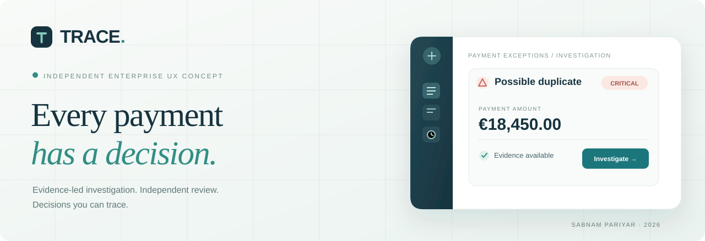

# TRACE — Every payment has a decision.

*Explore the payment workspace, then scroll to the interactive design direction and case study.*

*An independent enterprise UX case study by Sabnam Pariyar.*

I designed TRACE to explore a small but consequential moment in treasury operations: a payment is flagged, someone needs to understand why, and a decision must be made without losing its context.

The interactive prototype follows an exception from the first signal through investigation, independent review, and an auditable resolution. It is a fictional product concept, with illustrative financial data and no connection to live banking services.

## Explore the experience

The prototype is the centre of this case study. Open an exception, inspect its evidence, switch between analyst and approver roles, and see how the available actions change. Scroll further to explore the interactive moodboard, visual direction, design tokens, component states, and user journey.

### The design challenge

Payment operations are information-dense. My design question was: **how can an interface support confident decisions when urgency, evidence, and responsibility need to be understood together?**

I approached it through four ideas:

- **Signal:** help people identify what deserves attention without making the entire interface feel urgent.
- **Evidence:** keep the reason behind an exception close to the facts needed to assess it.
- **Control:** show which action is permitted, by whom, and why a second person may be required.
- **Trace:** preserve an understandable record of what happened and who made each decision.

## What you can try

1. Open **PAY-2048**, a possible duplicate payment.
2. Review its information and evidence; expand the rule-based explanation.
3. As **Mika Laine (analyst)**, start an investigation and request approval with a written reason.
4. Switch to **Leena Berg (approver)** and approve or reject that review.
5. Switch back to Mika to close an approved case; inspect the case history and audit activity.
6. Try **Alex Niemi (auditor)** to explore the read-only state, or **Reset demo** to start again.

The demonstration contains fictional payments in multiple currencies, searchable cases, priority filters, a role-aware workflow, action confirmations, and recorded decision history.

## Behind the design

I included the visual thinking in the experience itself, not just as a static screenshot. The moodboard cards turn to reveal design reasons. Color tokens can be selected and previewed. Reusable status and review components respond to interaction, and the user journey explains the decisions behind each stage.

For a deeper view of the reasoning, see my [UX case study](docs/UX-CASE-STUDY.md) and [visual design system](docs/DESIGN-SYSTEM.md).

## Scope and honesty

TRACE is a self-initiated portfolio exploration, **not** an official Nomentia product, customer assignment, or validated banking workflow. The companies, transactions, users, thresholds, cutoffs, explanations, and activity records are invented for the prototype. I have not claimed customer interviews or measured business results. The research and usability questions I would validate next are documented in the case study.

---

**Sabnam Pariyar** · UX / Product Design · Finland

